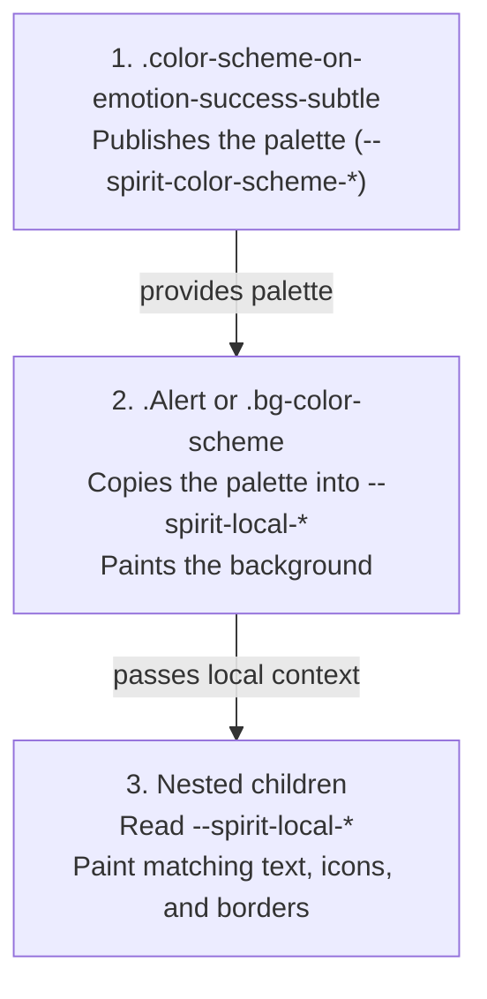
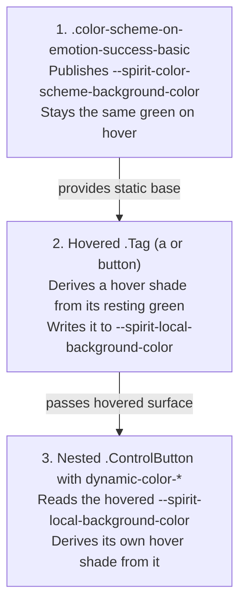
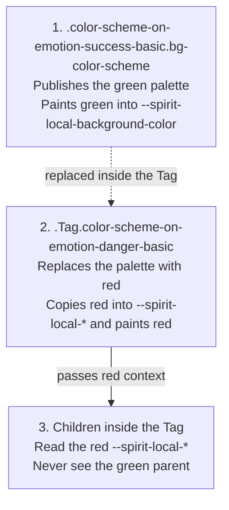
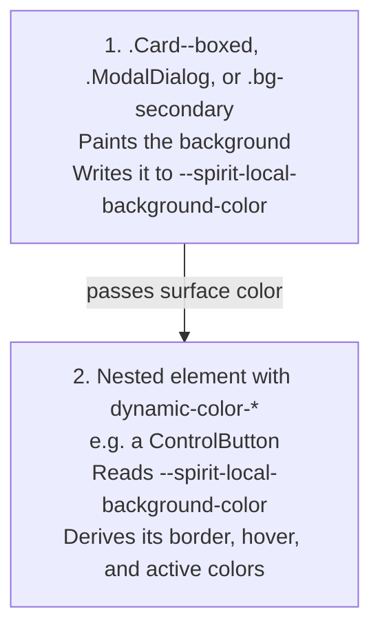
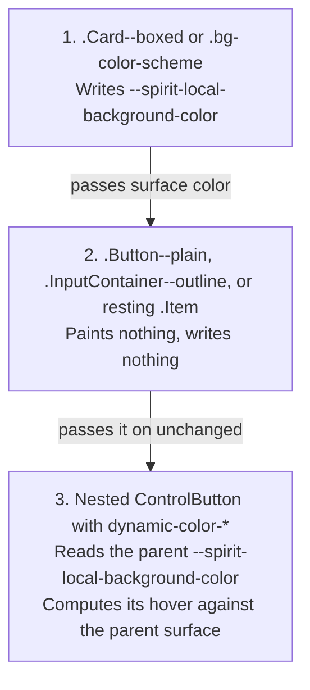
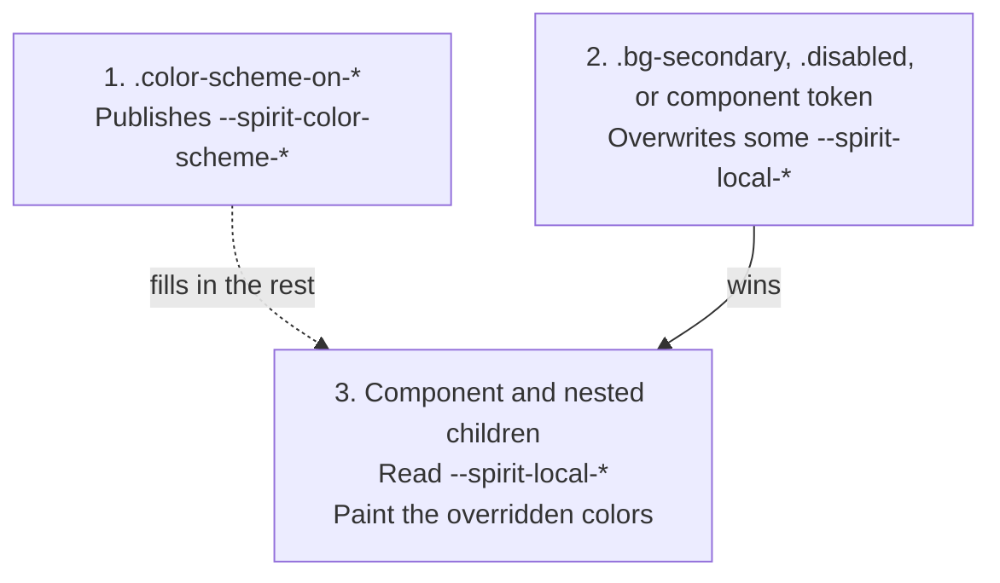

# Local Color Context

This guide explains how colors travel from a color scheme to the elements inside it, and what happens on hover,
inside nested schemes, and when something overrides them. For the basics — which color scheme CSS classes exist and
how to apply them — start with [Color Schemes](color-schemes.md).

## Palette vs Local Color Context

Spirit keeps two sets of CSS custom properties apart:

1. **Color scheme palette (`--spirit-color-scheme-*`)** — the colors a scheme _offers_.
   Only `.color-scheme-on-*` classes set them, for example `--spirit-color-scheme-color`,
   `--spirit-color-scheme-border-color`, and `--spirit-color-scheme-background-color`. They are read only and never
   change, not even on `:hover` or `:active`.
2. **Local color context (`--spirit-local-*`)** — the colors an element _actually uses right now_, for example
   `--spirit-local-color`, `--spirit-local-border-color`, and `--spirit-local-background-color`. Descendants inherit
   them, so nested elements always know what they sit on.

Who writes the local color context:

- **Surface components that consume a color scheme** (`Tag`, `Button`, `Alert`, `Pill`, `ToastBar`, `TooltipPopover`,
  `ProgressBar`) copy the palette into their locals and paint from them. That is what lets
  [component color overrides](color-schemes.md#overriding-scheme-colors-per-component) and `disabled` win locally.
- **Any other element that paints a surface** (`Card--boxed`, `UNSTABLE_Tile`, `ModalDialog`, `DrawerPanel`,
  `DropdownPopover`, `InputContainer--fill`, a hovered or active `Item`, or `bg-*` utilities) writes the background it
  paints into `--spirit-local-background-color`.

So `--spirit-local-background-color` always holds **the background painted right now**, including hover and active
states, component color overrides, and utility overrides.

### Intensity Variants vs State Variants

Some locals come in two **intensities**: `--spirit-local-color-basic`, `--spirit-local-color-subtle`,
`--spirit-local-background-color-basic`, and `--spirit-local-background-color-subtle`. They are fixed colors of one
surface that shows both intensities at once, such as the track and the indicator of a `ProgressBar` (see
[Combining Both Intensities](color-schemes.md#combining-both-intensities)).

**States are different.** Hover, active, and selected are transient, so there is no
`--spirit-local-background-color-state-*`. A surface writes its state color straight into
`--spirit-local-background-color`, and nested elements always read that one value.

### Interactive Surfaces

Interactive scheme surfaces (such as `Tag:is(a, button)`) compute their hover and active colors from their
**resting** background — the component color override if there is one, otherwise
`--spirit-color-scheme-background-color` — and write the result to `--spirit-local-background-color`. The resting
background is kept in its own custom property (`--spirit-tag-background-color`), so the surface never reads the value
it overwrites. `Button` takes its hover and active colors from the scheme state tokens (or its own component color
overrides) and writes them to `--spirit-local-background-color` the same way.

Nested dynamic elements (such as a `ControlButton` inside an interactive `Tag`) read the local value, so they follow
the parent's hovered or active background without a circular CSS custom property dependency. A dynamic element whose
hover is derived from the local background it inherits (`dynamic-color-background-interactive`) only paints its hover;
it cannot write it back without reading the value it overwrites.

## How Colors Flow

### Case 1: Static Surface (`Alert`, `Pill`, or `Box`)

The color scheme publishes the palette, the surface copies it into the locals and paints itself, and children read
the locals. Each scheme utility (`bg-color-scheme`, `text-color-scheme`, `border-color-scheme`) copies its own color
from the nearest palette into the locals and paints it, so an element with its own scheme inside an `Alert` shows its
own colors, not the `Alert`'s.

### Case 2: Interactive Surface with a Nested Button (`Tag` + `ControlButton`)

The palette stays the same while the surface changes on hover. The `Tag` derives its hover shade from its **resting**
color (the palette, or its component color override), not its own local color, so it never feeds its own output back
into itself:

### Case 3: Nested Color Scheme Override (Danger `Tag` Inside a Success Surface)

A nested color scheme replaces the palette for its subtree, and the surface carrying it copies the new palette into
the locals.

### Case 4: Surface Without a Color Scheme (`Card--boxed`, `ModalDialog`, or `bg-secondary`)

Opaque surfaces without a color scheme still write their background to `--spirit-local-background-color`, so nested
dynamic controls know what they sit on.

### Case 5: Transparent Component (`Button--plain`, `InputContainer--outline`, or Resting `Item`)

Transparent components paint nothing and write nothing in their default state, so the parent surface passes through.
As soon as they paint a state of their own (a hovered `Button--plain` or `Item`, a disabled `InputContainer`), they
write that color like any other surface.

### Case 6: Overriding a Component (`bg-*` Utility, `disabled`, or Component Token)

Overrides write straight to `--spirit-local-*` and win over the palette, which stays untouched and still supplies
every color that is not overridden:

- `bg-*` utilities override the background with `!important`, so hover and active no longer change it.
- `disabled` overrides text, border, and background colors with `!important`. Because hover and active write into the
  same local background, they stay disabled too. See [Disabled State](color-schemes.md#disabled-state).
- [Component color overrides](color-schemes.md#overriding-scheme-colors-per-component) override only the colors their
  tokens define. An interactive `Tag` takes its background override through `--spirit-tag-background-color`, so its
  hover and active colors are derived from it. `Button` takes its hover and active overrides through
  `--spirit-button-background-color-state-hover` and `--spirit-button-background-color-state-active`.

## Related

- [Color Schemes](color-schemes.md) — the overview: naming, pairing logic, and how to apply a scheme
- [ADR 017: Color Scheme Palette and Local Color Context][adr-local-color-context] — why the palette is read only
- [Dynamic Colors][dynamic-colors] — helpers that derive borders and interactive backgrounds from the local context

[adr-local-color-context]: https://github.com/alma-oss/spirit-design-system/blob/main/docs/decisions/017-color-scheme-palette-and-local-color-context.md
[dynamic-colors]: https://github.com/alma-oss/spirit-design-system/blob/main/packages/web/src/scss/helpers/dynamic-color/README.md
